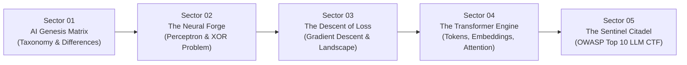

# 🧠 NEUROQUEST: The AI Protocol
### *Master Artificial Intelligence & LLM Defense From Scratch*

[](https://www.docker.com/)
[](https://react.dev/)
[](https://www.typescriptlang.org/)
[](https://vite.dev/)
[](https://tailwindcss.com/)
[](https://owasp.org/www-project-top-10-for-large-language-model-applications/)

---

## 🕹️ Overview

**NeuroQuest** is an interactive, gamified online learning platform and cyber sandbox engineered for students and developers to learn modern **Artificial Intelligence from absolute scratch** — from individual artificial neurons and gradient calculus to Large Language Models and **OWASP Top 10 LLM Security Defense**.

Students earn **XP**, unlock **Trophies**, advance through **Military/Cadet Ranks**, and receive a cryptographically verified **Certificate of Completion**.

---

## 🗺️ Curriculum & Playable Sectors



### 1. 🌐 Sector 01: The AI Genesis Matrix (Taxonomy & Foundations)
- **What is AI vs ML vs Deep Learning vs LLMs?** The nested Russian doll architecture demystified.
- **Rule-Based (Symbolic) AI vs Learned Systems**: A* search, expert logic trees vs data-driven weight optimization.
- **Interactive Taxonomy Sorter Game**: Categorize real-world systems (Deep Blue, Credit Card Fraud Random Forests, ResNet CT scan analyzers, GPT-4, Stable Diffusion) into their exact computational tier.
- **Technical Dimension Matrix**: Data requirements, feature engineering, and white-box vs black-box interpretability.

### 2. ⚡ Sector 02: The Neural Forge (Perceptrons & The XOR Crisis)
- **Anatomy of an Artificial Neuron**: $z = \sum w_i x_i + b$, $\hat{y} = f(z)$.
- **Live 2D Decision Boundary Canvas**: Drag weights ($w_1, w_2$) and bias ($b$) in real-time at 60 FPS to slice 2D coordinate space.
- **The Famous 1969 XOR Problem**: Experience why a single straight line can never separate $(0,1)$ and $(1,0)$ from $(0,0)$ and $(1,1)$, why it triggered the first AI Winter, and deploy a hidden layer (Multilayer Perceptron / MLP) to solve it!
- **Activation Functions Arena**: Compare Step (Heaviside), Sigmoid, Tanh, ReLU, and Leaky ReLU with live logit sliders, derivative readouts $f'(z)$, and explanations of vanishing gradients and dying neurons.

### 3. 📉 Sector 03: The Descent of Loss (Gradient Descent & Landscapes)
- **The Loss Function**: Mean Squared Error ($MSE$) as an elevation map.
- **Interactive Physics Landscape Sandbox**: Real-time ball rolling down a non-convex cost landscape $J(\theta)$.
- **Learning Rate ($\alpha$) Experiments**:
  - *Too Low ($\alpha = 0.005$)*: Model crawls and gets trapped in shallow local minima.
  - *Too High ($\alpha = 0.28$)*: Gradient explodes, loss diverges to infinity!
  - *Optimal Momentum ($\beta = 0.85$)*: Escapes local ravines and converges cleanly to the Global Minimum!
- **Backpropagation & The Chain Rule**: How error gradients flow backwards layer-by-layer through partial derivatives.

### 4. 🔤 Sector 04: The Transformer Engine (Tokens, Embeddings & Attention)
- **Byte-Pair Encoding (BPE) Tokenizer**: Live interactive subword decomposition and vocabulary token IDs.
- **Vector Embeddings Arithmetic**: Semantic vector math in coordinate space ($\text{Vector("King")} - \text{Vector("Man")} + \text{Vector("Woman")} \approx \text{Vector("Queen")}$) with Euclidean and Cosine distances.
- **Self-Attention Visualizer ("Attention Is All You Need")**:
  - Interactive multi-token focus matrix.
  - Disambiguate pronouns and polysemy (e.g. *"The animal did not cross the street because **it** was too tired"* vs *"too wide"*).
  - Formulas for Query ($Q$), Key ($K$), Value ($V$), and scaling factor $\frac{1}{\sqrt{d_k}}$.
- **Sampling Parameters**: Live sliders for Temperature ($T$) and Top-P (Nucleus Sampling).

### 5. 🛡️ Sector 05: The Sentinel Citadel (OWASP Top 10 for LLMs 2025)
Hands-on Cyber CTF Red-Team vs Blue-Team terminal for all 10 OWASP LLM vulnerabilities:
1. **LLM01: Prompt Injection**: Execute direct and indirect jailbreaks to bypass safety instructions and extract master secret keys.
2. **LLM02: Insecure Output Handling**: Neutralize reflected XSS and unencoded DOM injection from malicious LLM outputs with context-aware sanitizers.
3. **LLM03: Training Data Poisoning**: Analyze candidate fine-tuning rows and purge backdoor triggers (e.g., trojan triggers).
4. **LLM04: Model Denial of Service**: Stop GPU memory sponge attacks by implementing sliding token windows and token-bucket rate limiting.
5. **LLM05: Supply Chain Vulnerabilities**: Detect unsafe Python `.pickle` arbitrary code execution payloads in weights and migrate to verified `safetensors`.
6. **LLM06: Sensitive Information Disclosure**: Deploy egress Data Loss Prevention (DLP) regex filters to prevent AWS keys and SSNs from leaking.
7. **LLM07: Insecure Plugin Design**: Audit tool functions and replace raw SQL concatenation with parameterized binding and least-privilege scoping.
8. **LLM08: Excessive Agency**: Enforce Human-in-the-Loop (HITL) approval gates before autonomous agents can trigger destructive database operations.
9. **LLM09: Overreliance**: Cross-reference hallucinated citations with verified RAG vector databases to eliminate fabricated legal precedents.
10. **LLM10: Model Theft**: Deploy syntactic watermarking and cluster rate-limits to block automated model extraction and distillation attacks.

---

## 🚀 Running with Docker (Recommended)

NeuroQuest is fully containerized using a lightweight, multi-stage Docker build with Nginx (~25MB image size).

### Quick Launch with Docker Compose:
```bash
docker compose up --build -d
```
Open your browser at:
👉 **[http://localhost:3000](http://localhost:3000)**

### Or using standalone Docker CLI:
```bash
# 1. Build the Docker image
docker build -t neuroquest-ai .

# 2. Run the container
docker run -d -p 3000:80 --name neuroquest-game neuroquest-ai
```

To stop the container:
```bash
docker stop neuroquest-game
# or
docker compose down
```

---

## 💻 Local Development (Without Docker)

NeuroQuest requires **Node.js (v18+)** and **npm**:

```bash
# 1. Clone or navigate to the directory
cd quirky-brahmagupta

# 2. Install dependencies
npm install

# 3. Start local development server with Hot Module Replacement
npm run dev
```

Visit `http://localhost:5173` in your browser.

To build the static distribution:
```bash
npm run build
npm run preview
```

---

## 📤 Pushing to Your GitHub Repository

To upload this complete project to your personal GitHub account:

### Step 1: Create a new repository on GitHub
1. Go to [github.com/new](https://github.com/new).
2. Enter a repository name (e.g. `neuroquest-ai-game` or `ai-learning-game`).
3. Set visibility to **Public** (or **Private**).
4. Do NOT initialize with a README, .gitignore, or license (we already created them).
5. Click **Create repository**.

### Step 2: Initialize & push from your local terminal
Open terminal in the project directory and run:

```bash
# 1. Check git status
git status

# 2. Add all files to staging
git add .

# 3. Commit changes
git commit -m "feat: Initial release of NeuroQuest AI educational game with Docker & OWASP LLM Top 10"

# 4. Set main branch
git branch -M main

# 5. Connect your GitHub remote repository (replace with your actual GitHub URL)
git remote add origin https://github.com/YOUR_USERNAME/neuroquest-ai-game.git

# 6. Push to GitHub
git push -u origin main
```

---

## 🏆 Gamification Highlights

- **XP & Level Progression**: Earn XP on every mini-game, challenge, and lab experiment.
- **Ranks**:
  - `Neural Initiate` (0 XP)
  - `Perceptron Tinkerer` (250 XP)
  - `Gradient Alchemist` (600 XP)
  - `Transformer Architect` (1,200 XP)
  - `OWASP Sentinel Commander` (2,000+ XP)
- **Built-in Web Audio Synthesizer**: Retro arcade 8-bit / sci-fi sound effects generated in pure Web Audio API without external audio files (with mute button).
- **Certificate Generator**: Dynamic print/download certificate with student name, verified timestamp, and security hash.

---

## 📜 License
Distributed under the MIT License. Perfect for universities, high schools, coding bootcamps, and cybersecurity clubs!
